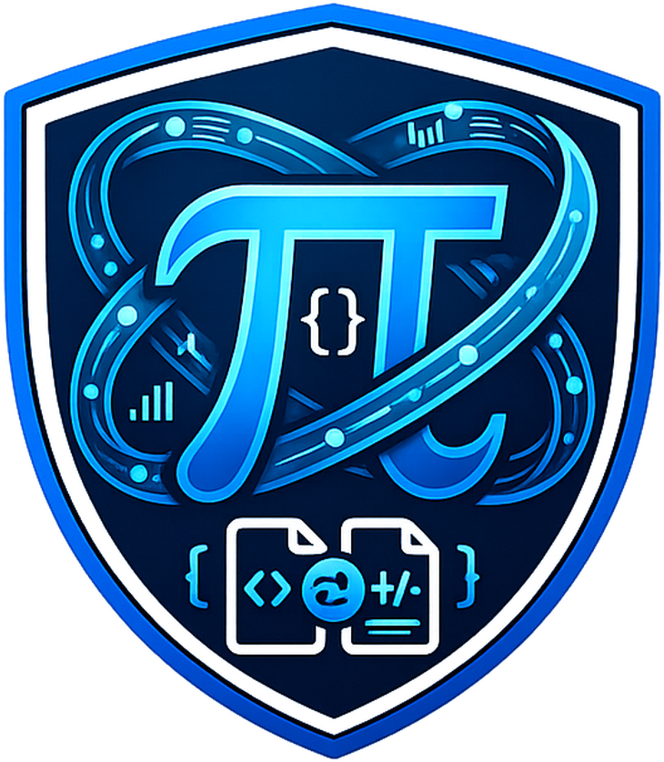
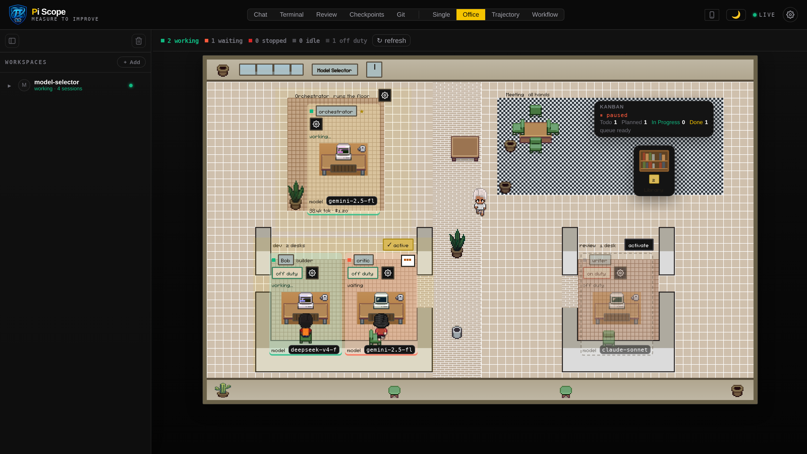

<p align="center">
  
</p>

<p align="center">
  <b>Watch an AI coding agent think, type, and act — <i>live, locally, and replayable.</i></b>
</p>

<p align="center">
  <a href="https://nerdatwork24x7.github.io/Pi_Scope/"><b>Website</b></a> ·
  <a href="https://nerdatwork24x7.github.io/Pi_Scope/guide.html"><b>Docs</b></a> ·
  <a href="docs/shots/office-dark.png"><b>Screenshots</b></a> ·
  <a href="https://github.com/NerdAtWork24X7/Pi_Scope/releases"><b>Releases</b></a>
</p>

---

Pi Scope is a **local-first control room for AI coding agents**. It streams everything your
agent does — every message, tool call, shell command and file edit — into a browser dashboard
you can watch **live** over SSE, or **replay** later like a movie of your agent's brain.

It runs on *your* machine, needs no account, and uploads nothing. And unlike a terminal log,
it lets you **act**: open a real shell, edit the agent's diffs, snapshot your work with git
checkpoints, and run a full git client — from the same screen.

<p align="center">
  
</p>

### What makes it different

| | Pi Scope | Cloud LLM tracers | Terminal / chat logs |
|---|:---:|:---:|:---:|
| Runs locally, nothing uploads | ✅ | ❌ | ✅ |
| Live watching of agent actions | ✅ | ⚠️ traces only | ⚠️ scrolling text |
| Replay past sessions | ✅ | ✅ | ❌ |
| Control surface (shell, diffs, git) | ✅ | ❌ | ⚠️ manual, elsewhere |
| Coding-agent aware (tool calls, cwd, context %) | ✅ | ⚠️ LLM-centric | ❌ |
| Exact LLM request args captured | ✅ | ⚠️ varies | ❌ |
| Zero-install AppImage with bundled Node | ✅ | n/a | n/a |

Nine views ship by default — **Chat, Single, Office, Trajectory, Workflow, Terminal, Review,
Checkpoints, Git** — plus **Settings**, and every view is a plugin you can disable or replace.
See the [feature tour](https://nerdatwork24x7.github.io/Pi_Scope/#tour) for screenshots of all
of them.

## Quick start

**Linux — zero install.** Grab the AppImage from
[Releases](https://github.com/NerdAtWork24X7/Pi_Scope/releases) (Node 24 is bundled inside):

```bash
curl -fsSL -o Pi-Scope-1.0.0.AppImage \
  https://github.com/NerdAtWork24X7/Pi_Scope/releases/download/V1.0.0/Pi-Scope-1.0.0.AppImage
chmod +x Pi-Scope-1.0.0.AppImage && ./Pi-Scope-1.0.0.AppImage
```

**Linux, macOS & Windows — clone it (Node 24+):**

```bash
git clone https://github.com/NerdAtWork24X7/Pi_Scope.git Pi_Scope && cd Pi_Scope
./pi-scope                         # desktop app; --web for a headless server, --server to stay put
```

No display (a server, container or SSH session)? The desktop window cannot open there —
start the headless server instead:

```bash
./pi-scope --server
```

```powershell
git clone https://github.com/NerdAtWork24X7/Pi_Scope.git Pi_Scope; cd Pi_Scope
.\pi-scope.cmd                     # same launcher, same modes
```

Nothing else to install. `pi-scope` is the launcher on all three platforms —
`pi-scope.mjs` plus a shim each — so the modes and flags below are the same
everywhere. Its first launch fetches Pi Scope's dependencies — Electron for the
desktop window, the build tooling, and Pi Scope's own copy of the `pi` coding
agent — into one shared project in your data dir (`~/.pi-scope/pi`), so the
checkout keeps no `node_modules`, there is no global `pi` install and no manual
`npm` step.
Every flag is under [Launcher flags](https://nerdatwork24x7.github.io/Pi_Scope/guide.html#launcher).

Want to see it before wiring up an agent? With the server running, seed a realistic demo
session:

```bash
node docs/seed-demo.mjs
```

The dashboard comes alive when a `pi` agent feeds it — and Pi Scope **bundles its own**. Chat,
the commit-message generator and the in-browser terminal all launch that copy with the Pi Scope
extension force-loaded, in its own agent dir (`~/.pi-scope/agent`), so nothing to install and no
interference with a global `pi`. On first launch Pi Scope seeds that agent dir from the starter
config in `examples/pi_local/agent` (settings, skills, extensions) whenever it finds no
`extensions/` yet — the tell that nothing has set it up. Once the dir has extensions it is left
alone, and the launcher never overwrites an existing file, so seeding it alongside the server's own
`auth.json` / `models-store.json` is harmless. Any other tool can feed it too: just `POST` events
to `/events`.

## Documentation

The detail lives in the docs, not here — this file is the front door.

| Where | What's in it |
|---|---|
| 🌐 **[Website](https://nerdatwork24x7.github.io/Pi_Scope/)** | Feature tour, real screenshots, comparison, install options |
| 📘 **[Setup guide](https://nerdatwork24x7.github.io/Pi_Scope/guide.html)** | Prerequisites, every install path, phone access, all environment variables |
| 🛠️ [`apps/scope-server/README.md`](apps/scope-server/README.md) | The HTTP API: endpoints, auth rules, the SSE stream |
| 🔌 [`apps/scope-server/plugins/README.md`](apps/scope-server/plugins/README.md) | Write a plugin: manifests, routes, event hooks, storage |
| 🤖 [`extension/README.md`](extension/README.md) | Telemetry extension flags, env vars and the event reference |
| 🧪 [`docs/seed-demo.mjs`](docs/seed-demo.mjs) | The script that creates the demo session behind the screenshots |
| 📁 [`docs/README.md`](docs/README.md) | How the docs site itself is laid out and published |

**Want to know what's actually captured?** Session start/end, every user and assistant message,
thinking blocks, tool calls and results with exit codes, the LLM request arguments and system
prompt, model changes, compactions and branch navigation.

**Where does it live?** One SQLite file — `db/scope.db` in a clone (resolved from the repo root,
even though the server runs in `apps/scope-server/`), `~/.pi-scope/` when packaged — created mode
`0600`. Delete a session from the sidebar, or `DELETE /sessions` for everything.

**Two windows at once?** The desktop app checks its port before booting. If it is taken, it shows a
port console — open the running instance, kill a port (or just free it and quit), and start a second,
fully independent instance on another port (its own token and database). It also lists every Pi Scope
server the machine has listening, each with its own Kill button. See
[Port already in use](https://nerdatwork24x7.github.io/Pi_Scope/guide.html#port-in-use).

**What does the first run download?** Everything the app needs — Electron
(desktop mode), the build tooling, Pi Scope's own `pi` coding agent with its
runtime packages — into one shared project in `~/.pi-scope/pi` (~1 GB) — plus the
shared Python environment in `~/.pi-scope/.venv` that the `web-fetch` extension
and `video-creator` skill share. The
checkout itself stays free of `node_modules`. It happens once.

**Uninstalling?** Delete the checkout, then remove `~/.pi-scope/` for a clean slate — the database,
the agent dir and the bundled `pi` all live there. (A clone's database may also be at
`db/scope.db` inside the checkout you are deleting.)

## Repository layout

- **`apps/scope-server/`** — the server, dashboard and built-in feature plugins
- **`apps/scope-desktop/`** — the Electron shell, launcher and the bundled-`pi` installer (the agent itself is installed into `~/.pi-scope/pi`)
- **`extension/`** — the `pi` extension that streams telemetry
- **`pi-scope` / `pi-scope.cmd`** — the cross-platform launcher (`pi-scope.mjs` core plus platform shims)
- **`docs/`** — the published docs site (plain HTML/CSS/JS, no build step) and its screenshots
- **`examples/`** — an installable example plugin (`plugins/`) and the starter agent config (`pi_local/agent`)

Every feature is a plugin, so the fastest way to change Pi Scope is usually to write one rather
than edit the core.

## License

[MIT](LICENSE).
